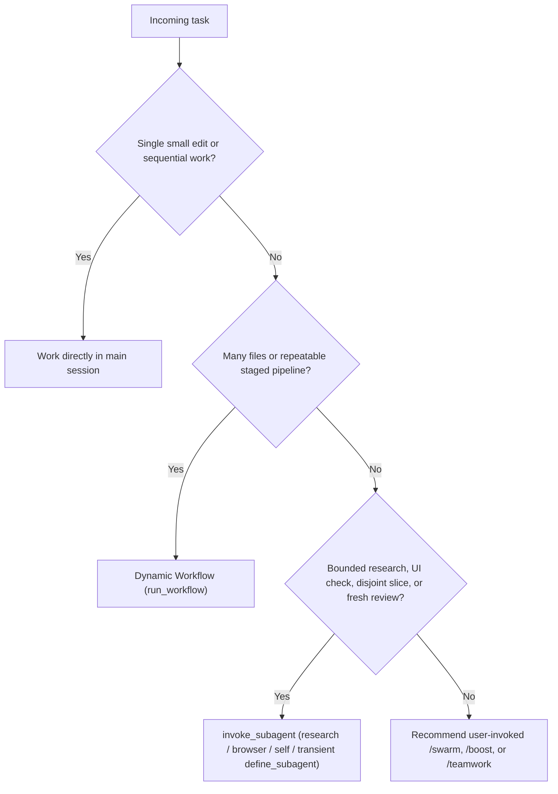

# Native Antigravity orchestration

> Using OpenCode? See [Native OpenCode orchestration](opencode-orchestration.md). Both harnesses share the same unified [`skills/orchestration/SKILL.md`](../skills/orchestration/SKILL.md).

This repository uses a **skill-only** orchestration layer over **Google Antigravity** (App, CLI `agy`, IDE, and IDE extensions). It preserves high-signal routing, workspace isolation, and verification gates without shipping a plugin, hooks, session bootstrap, custom background daemon, or hardcoded model profiles.

## Routing flow



## What it is

`skills/orchestration/SKILL.md` tells the primary session when to:

- work directly in a single conversation;
- delegate one bounded task or parallel read-only investigations with `invoke_subagent` (`research`, `browser`, `self`, transient `define_subagent`, or pre-existing custom agents);
- isolate concurrent writers with native `share` or `branch` workspaces and serialize shared files;
- orchestrate repeatable fan-out or staged pipelines with `run_workflow` (Dynamic Workflows);
- request an independent read-only review before integration and delivery;
- recommend Antigravity's built-in user-invoked orchestrators (`/swarm`, `/boost`, `/teamwork`) when the task warrants them.

## Antigravity's native orchestration primitives

Antigravity ships five built-in execution patterns across its surfaces. The `orchestration` skill routes across them without installing any extra runtime:

| Pattern | Trigger | Mechanism & isolation | Best for |
|---|---|---|---|
| **Single agent** | Direct work | One session reads, edits, and verifies sequentially | Small fixes, single-file edits, sequential decisions |
| **Subagents** (`invoke_subagent`, `define_subagent`, `send_message`, `manage_subagents`) | Agent-invoked | Built-in `research` (read-only sandbox, no network), `browser` (live UI/DOM/console), `self` (full clone), transient `define_subagent`, or user `~/.gemini/config/agents/*.md` / workspace `.agents/agents/*.md`; workspaces `inherit` / `share` / `branch`; reactive wakeup (no polling); nesting depth cap 10 | Focused research sweeps (≤3 parallel), live browser checks, disjoint implementation slices, fresh read-only review |
| **Dynamic Workflows** (`run_workflow` / `/run-workflow`) | Agent- or user-invoked (all plans) | Python script coordinating `agent()`, `parallel()`, `pipeline()`, `phase()`, and JSON Schema `finish` results (`inherit` / `share` / `branch`, model tiers `inherit` / `flash_lite` / `flash` / `pro`) | Fan-out audits across many files/modules, repeatable staged pipelines, structured reviewer-fixer loops |
| **Swarm** (`/swarm`) | User-invoked only (all plans) | Coordinator + named workers + `@verifier` collaborating on a shared message board with `@mentions`; idle workers sleep at zero token cost | Broad tasks dividing cleanly across independent files, packages, or investigation tracks where peers coordinate directly |
| **Boost (`/boost`) & Teamwork (`/teamwork`)** | User-invoked only (paid plans) | `/boost`: iterative implement → challenge → fix → verify; `/teamwork`: scoping interview + milestone teams (`Critic`, `Challenger`, `Auditor`, `Success Auditor`) in `~/teamwork_projects/` | `/boost` for hard bugs, races, and algorithms; `/teamwork` for multi-milestone migrations or multi-day campaigns |

`invoke_subagent` runs asynchronously in the background and returns a `conversationId`. Idle subagents retain their context and re-awaken automatically when sent a follow-up via `send_message`; launching a fresh `invoke_subagent` gives an isolated clean slate for independent review. Killing a subagent via `manage_subagents` permanently terminates it and deletes any `share`/`branch` workspace, so changes must be integrated before cleanup.

## Comparison

| Concern | Plugin-heavy agent frameworks | This repository (over native Antigravity) |
|---|---|---|
| Runtime | Custom plugin, background job daemon, TUI overlay, bootstrap hooks | One portable Markdown skill over native Antigravity tools (`invoke_subagent`, `define_subagent`, `run_workflow`) |
| Agents | Bundled specialist packs and hardcoded presets | Built-in `research`, `browser`, `self`, transient `define_subagent(EnableWriteTools=false)`, or user-configured `~/.gemini/config/agents/*.md` |
| Model / effort selection | Hardcoded provider/model profiles | Model-agnostic by default (`inherit`); optional per-task tier hints (`flash_lite`, `flash`, `pro`) via Antigravity |
| Hooks / bootstrap | Required | None |
| Workspace isolation & monitoring | Custom shell wrappers | Native `inherit` / `share` / `branch` workspaces, reactive wakeup, App Side Panel / CLI `/agents`, `/tasks`, `Alt+J`, `Ctrl+K` |
| Main risk | Maintenance surface and lock-in | Routing discipline, explicit write ownership, and landing `share`/`branch` changes before killing workers |

The goal is not to rebuild Antigravity's built-in orchestrators in Markdown. It is to enforce the engineering discipline that changes outcomes: route the right work, protect context, keep one writer per file, review material diffs independently, and verify completion with evidence.

## Zero-config use

Install the skills into Antigravity's global personal skills directory (`~/.gemini/config/skills/`, shared across Antigravity App, CLI, and IDE):

```bash
./install/antigravity.sh --copy
```

Alternatively, point `~/.gemini/config/skills.json` at your clone's `skills/` directory for a zero-copy setup.

Then describe complex work in plain language or invoke `/orchestration` directly. Antigravity loads the skill progressively from its `description`, and native subagent / workflow tools handle delegation without plugins, hooks, or project-local agent definitions.

If your user scope (`~/.gemini/config/agents/`) or project (`.agents/agents/`) already defines custom agents (for example a dedicated read-only `reviewer`), pass that agent name as `TypeName` to `invoke_subagent` or `type_name` in `run_workflow`. This skill never installs or modifies agent definitions.

## Routing examples

**Map before changing (`research` subagent)**

```text
TypeName: research
Role: Auth Flow Researcher
Prompt: Map the authentication entry points, session storage, and callback paths.
Read-only. Return file paths, line ranges, and a short flow summary.
```

**Two independent writers (`self` with `workspace: "branch"` or `"share"`)**

```text
Writer A (workspace: branch): owns src/parser/ and its tests.
Writer B (workspace: branch): owns src/renderer/ and its tests.
(Use workspace: share when you want shared repository storage without duplicating history.)
Do not touch shared types; report any needed interface change instead.
Integrate both workspaces on the integration branch before killing subagents.
```

**Fresh read-only review (`define_subagent` with `EnableWriteTools: false`)**

```text
Define transient read-only reviewer (EnableWriteTools: false).
Invoke fresh subagent with spec, BASE..HEAD commit SHAs, explicit changed file paths
(or diff excerpt, since EnableWriteTools: false also disables shell tools), and parent test outputs.
Report P0/P1/P2 findings with file:line, evidence, impact, and a concrete fix; mark shell checks NOT_TESTED.
Run actual test/mutation verification in the main session or a separate isolated runner.
```

**Fan-out audit across many files (`run_workflow`)**

```text
Use run_workflow with phase("Discover") + parallel(files, lambda f: agent(..., type_name="research", model="flash", schema=...))
to audit each changed module independently and collect structured findings.
```

## Limits

- **No bundled model or effort presets.** Antigravity natively exposes model tiers (`inherit`, `flash_lite`, `flash`, `pro`) and user-configured models (`/model`, `/effort`); this skill stays model-agnostic.
- **No unprompted `/swarm`, `/boost`, or `/teamwork` launches.** The skill recommends these built-in orchestrators to the user when the task shape warrants them; it never starts a swarm without an explicit `/swarm` invocation.
- **No sandbox or permissions modified by the skill.** Permissions (`Deny > Ask > Allow`), terminal sandboxing (`auto` mode / `--sandbox`), and non-workspace access are configured exclusively in the user's Antigravity settings (`~/.gemini/config/` and `~/.gemini/antigravity-cli/settings.json`). For hard read-only subagent enforcement without global config changes, use built-in `research` or `define_subagent` with `EnableWriteTools: false`.
- **No automatic orchestration on every prompt.** Small sequential edits and single-file changes stay direct in the main conversation.

## Verification

- `python3 scripts/validate.py` checks skill frontmatter (`name` matching folder ID, `description`, `compatibility`), links, and reading budgets.
- `tests/test_skill_suite.py` verifies the Antigravity routing contract, cross-skill trigger isolation, and absence of OpenCode-specific runtime terms in `skills/`.
- `make check` runs the full repository validation suite.

See [the plan](plan.md) for the task record and [`skills/orchestration/SKILL.md`](../skills/orchestration/SKILL.md) for the operational instructions.
